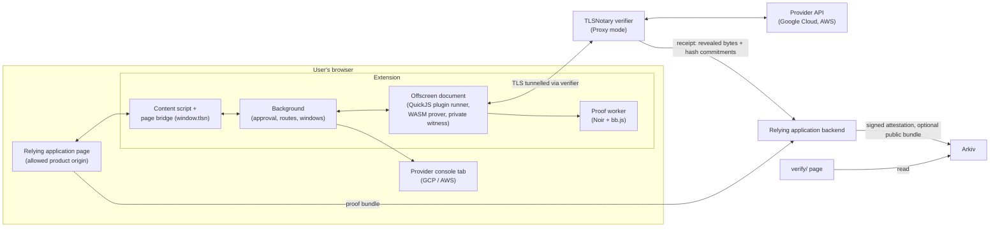
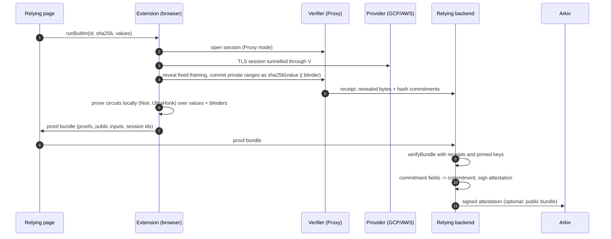

# Architecture

This fork keeps the upstream TLSNotary extension (release `0.1.0.1501`, see [`fork/VERSION`](../fork/VERSION)) and adds
private, in-browser zero-knowledge proofs over cloud console sessions, a locked-down way to run them, and a small set
of packages to publish and check the result. This page describes what was added and how the pieces fit.

## What the fork adds

| Area | Upstream | This fork |
| --- | --- | --- |
| Plugins | The page sends plugin JavaScript; the user approves it | Plugins are packaged inside the extension (built-in plugins); the page names one by id and sha256 and passes values, never code |
| Page API | `window.tlsn` on every page | Extension id, helper status and built-in runs only on build-time product origins; `window.tlsn` is locked to this extension there |
| TLSNotary core | Published `tlsn-wasm` | A pinned, patched core (`core/`) built into the WASM prover |
| Privacy | Reveal or hash ranges of the transcript | Private values are hashed with a blinder, then proven in zero knowledge in the browser (Noir circuits) |
| Evidence | A transcript or webhook payload | A coarse claim, a signed attestation over a commitment, and an optional public proof bundle, published to Arkiv |

## Components



### Extension (`packages/extension`)

- **Content script and page bridge** (`entries/Content`). Injects the page API. On allowed origins
  ([`constants/productOrigins.ts`](../packages/extension/src/constants/productOrigins.ts)) it exposes the extension id
  and helper status, and [`pageApiLock.ts`](../packages/extension/src/entries/Content/pageApiLock.ts) defines
  `window.tlsn` as a non-configurable accessor so another TLSNotary extension cannot replace it. Elsewhere it behaves
  as upstream. The origin list is fixed at build time; with no list, no origin is allowed.
- **Background** (`entries/Background`, `background/`). Decides whether a run may start (top frame, allowed origin,
  known built-in plugin id and fingerprint, valid values), opens and manages the provider window, and holds a
  single-use route per run. Private results are accepted only from the extension's own offscreen document on a live
  route ([`background/gcpPrivateCompletion.ts`](../packages/extension/src/background/gcpPrivateCompletion.ts)); AWS
  console credentials are captured once from the managed tab, never taken from the page
  ([`background/awsPrivateCapture.ts`](../packages/extension/src/background/awsPrivateCapture.ts)).
- **Offscreen document** (`offscreen/`). Runs the plugin in QuickJS and drives the WASM prover.
  [`builtinRun.ts`](../packages/extension/src/offscreen/builtinRun.ts) loads the packaged plugin file, checks its
  sha256 and fills in the run values as string literals only. For private runs,
  [`gcpPrivateWitness.ts`](../packages/extension/src/offscreen/gcpPrivateWitness.ts) and
  [`awsPrivateWitness.ts`](../packages/extension/src/offscreen/awsPrivateWitness.ts) own the transcript bytes and
  blinders for the run: nothing exposes them through a getter, a message or storage, and they are erased when the
  run settles.
- **Built-in plugins** ([`constants/builtinPlugins.ts`](../packages/extension/src/constants/builtinPlugins.ts)).
  Chrome MV3 forbids running remotely fetched code, also as data through an interpreter. The plugins are therefore
  built into the package (`builtin-plugins/<id>-<sha256>.js`) and indexed at build time; the page calls
  `window.tlsn.runBuiltIn()` with an id, a fingerprint and values. Verifier and proxy URLs and the parameters are
  substituted into the extension's own copy, and the result must map back to the packaged file byte for byte.
- **Navigation targets** ([`constants/pluginNavigate.ts`](../packages/extension/src/constants/pluginNavigate.ts)).
  An approved run may send its own managed window to one of a build-time list of exact https URLs (for example an
  account switcher), and nowhere else. The default list is empty.

### Pinned TLSNotary core (`core/`)

[`core/VERSION`](../core/VERSION) pins the TLSNotary core (`v0.1.0-alpha.15`) and MPZ (`v0.1.0-alpha.6`) by commit,
and pins each patch series (`core/patches`, `core/mpz-patches`) by one sha256 over the sorted patch files.
[`prepare-core.sh`](../core/prepare-core.sh) refuses an empty or changed series. The patches add mux backpressure,
batch synchronisation, multi-reveal sessions and fixes needed by the private proofs. Prover and verifier must run the
same patched core. [`fork/build-wasm.mjs`](../fork/build-wasm.mjs) builds the WASM prover from it with a pinned Rust
toolchain.

### Private proofs (`private-proof/gcp`, `private-proof/aws`)

Each package holds:

- **Noir circuits** (`circuits/`), compiled with a pinned Noir compiler. Verification-key hashes are pinned in
  `generated/verification-keys.json` (GCP) and `generated/pins.json` (AWS).
- **A client plan and in-browser prover** (`client-plan.mjs`, `browser-client.mjs`, `browser-worker.mjs`,
  `proof-runtime*.mjs`). The plan locates each private value in the transcript; the worker proves the circuits with
  `@noir-lang/noir_js` and `@aztec/bb.js` (UltraHonk) inside the browser.
- **A bundle verifier** (`verify-bundle.mjs`, `authenticated-transcript.mjs`). Given verifier receipts the caller has
  already authenticated, it checks that every proof's hashed inputs match a commitment the verifier recorded, that
  each claimed length matches the committed range, and that the proofs verify against pinned keys. Only the bundle is
  treated as untrusted input.

GCP runs six TLS sessions (one identity session, five batches of log queries) and proves which skill groups had
activity in a 7, 30 or 90-day window. AWS runs two (identity and one CloudTrail event) and proves that an IAM user
updated a role trust policy in the last 90 days.

### Verifier server role (Proxy mode)

The verifier is upstream's server ([`servers/verifier`](../servers/verifier), documented in
[`VERIFIER.md`](../VERIFIER.md)). The private proofs use **Proxy mode**: the verifier opens the TCP connection to the
provider and the browser tunnels its TLS session through it. The verifier records the bytes the prover reveals (HTTP
framing and other fixed text) and, for each private range, only a SHA-256 hash commitment. When a session ends it
sends a receipt to the configured backend. The bundle verifiers accept only receipts whose mode is `Proxy`.

### CROPS packages (`crops/`)

| Package | Role |
| --- | --- |
| [`crops/proof-bundle`](../crops/proof-bundle) | Canonical JSON, the bundle commitment, Ed25519 attestations, and the adapter from a verified GCP or AWS bundle to commitment fields |
| [`crops/pin-registry`](../crops/pin-registry) | Publish and find attestations and public bundles on Arkiv ([arkiv.md](arkiv.md)) |
| [`crops/personhood`](../crops/personhood) | Optional World ID one-human-per-job check ([world-id.md](world-id.md)) |

All three are plain ES modules (Node 22+ and current browsers), with no build step.

### Verify page (`verify/`)

A static page that looks up a commitment on Arkiv and checks it in the viewer's browser. See
[verification.md](verification.md).

## Data flow of a cloud private proof



**Stays in the browser.** The plaintext transcript, every private value (email addresses, account and project ids,
the API key, log entries), the 16-byte random blinder of each value, and the circuit witnesses. The witness owner
erases its copies when the run ends.

**Committed.** Each private range becomes `sha256(value ‖ blinder)`. Without the blinder a short or guessable value
cannot be confirmed by hashing candidates. The verifier sees only these hashes and the revealed framing.

**Seen by the verifier.** The user's IP address, the hosts contacted, timing and traffic sizes, the revealed framing,
and the blinded commitments. It never sees the private values or the blinders.

**Proven.** The zero-knowledge proofs show that the committed values have the required structure and meet the policy
(for example that a log entry falls inside the window, or that the identity and the event belong to the same
account). Their public inputs include the blinded hashes, the lengths of hidden values and the time cutoff.

**Learned by the relying party.** The coarse claim only, for example `gcp:observed:g1,g4` with a 30-day window, or
`aws:iam-role-trust-update:iam-user` with a 90-day window. The claim format admits only lowercase words, digits and
separators ([`commitment.mjs`](../crops/proof-bundle/commitment.mjs)), so no free text or identifier fits.

**Published.** The attestation (claim, proof hash, verification-key hashes, optional core and plugin digests, times)
and its signature; the public bundle only if the operator chooses to ([arkiv.md](arkiv.md#what-is-kept-off-arkiv)).

The commitment is `sha256` of the canonical JSON of `{ v: 1, domain: "tlsn-fork/proof-bundle", provider, claim,
proofHash, window?, vkHashes?, coreDigest?, pluginSha256? }`, where `proofHash` is `sha256` of the canonical public
bundle (proofs and public inputs, without session ids).

## Trust model

| Party | Trusted for | Not trusted for |
| --- | --- | --- |
| Extension build | Running only packaged plugins, keeping witness data local | Nothing beyond its own code; it is reproducible from this repository |
| TLSNotary verifier | Observing a real TLS session with the provider and recording the commitments honestly | Seeing private values (it only gets blinded hashes) |
| Relying backend / attestation signer | Checking the bundle against the receipts before signing | Seeing private values (it gets the claim, bundle and commitments only) |
| Provider | Serving the account's real data | Learning anything about the proof; it sees an ordinary session |
| Arkiv | Keeping published entities readable until expiry | Integrity of content: anyone can write, so readers verify signatures |

Assumptions:

- A transcript is only as authentic as the verifier that observed it. In Proxy mode the verifier sees the server's
  TLS records directly; it is not a co-holder of the session keys as in MPC-TLS. Anyone can run their own verifier
  from this repository and publish its key.
- The attestation key lives only in the signer's environment. Its public key is listed in
  [`verify/keys.json`](../verify/keys.json).
- The circuits and their pinned verification keys are correct. They are open source and pinned by hash.
- The user's browser and machine are not compromised.

## Build

`npm run build:fork` runs [`fork/build.sh`](../fork/build.sh). It builds the working tree in place: private-proof
circuits and workers, the pinned WASM prover, upstream's webpack build, the built-in plugins,
`THIRD_PARTY_NOTICES.txt` and the manifest. Output: `fork/out/extension` (unpacked MV3), plus
`fork/out/extension-id.txt` when a key is given. All variables are optional for a development build.

| Variable | Meaning |
| --- | --- |
| `FORK_PRODUCT_ORIGINS` | Comma-separated origins allowed to use the page API. Dev default: `http://localhost:5173`, `http://127.0.0.1:5173` and the same on port 5175. Required, https and non-loopback, with `FORK_KEY_FILE` |
| `FORK_PLUGIN_DIR` | Directory of built plugin bundles `<id>.js`, packaged as the built-in plugins. Without it the extension can run nothing; required with `FORK_KEY_FILE` |
| `FORK_KEY_FILE` | Base64 DER public key written as the manifest `key` (stable extension id). Marks a production build |
| `FORK_NAME` | Manifest name (default `TLSN Extension (dev)`, or `TLSN Extension` with a key) |
| `FORK_DESCRIPTION` | Manifest description, at most 132 characters |
| `FORK_ICON_DIR` | Directory with `icon-16.png`, `icon-34.png`, `icon-48.png`, `icon-128.png` |
| `FORK_NAVIGATE_URLS` | Comma-separated exact https URLs (no query or fragment) a plugin may send its own window to. Default none |
| `FORK_EXTRA_HOSTS` | Comma-separated extra host match patterns (`https://host/path*`) for content scripts and host access, for example for those navigation targets. Default none |
| `GCP_NOIR_NARGO` | The pinned Noir compiler (default: `nargo` on `PATH`) |

Host access is fixed to the GCP and AWS console and API hosts the private proofs use, the product origins, and
`FORK_EXTRA_HOSTS`. The verifier is reached by WebSocket from the offscreen document and needs no host permission.
The build checks the final manifest permissions (`offscreen`, `webRequest` only).

## Repository layout

```text
core/                 pinned TLSNotary core + MPZ, patch series, prepare-core.sh
fork/                 build.sh, WASM build, built-in plugin index, third-party notices
packages/extension/   the extension (upstream + fork changes)
packages/plugin-sdk/  plugin SDK (upstream + fork changes)
private-proof/gcp/    GCP circuits, client plan, browser prover, bundle verifier
private-proof/aws/    AWS circuits, client plan, browser prover, bundle verifier
crops/proof-bundle/   commitment and attestations
crops/pin-registry/   Arkiv read/write
crops/personhood/     optional World ID check
verify/               static verify page and keys.json
servers/verifier/     upstream TLSNotary verifier server
docs/                 this documentation
```
