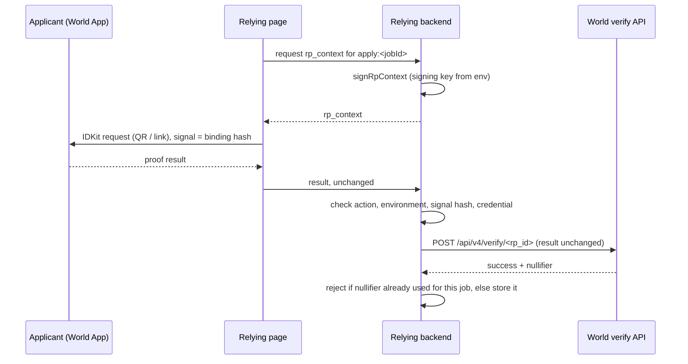

# World ID (optional)

[`crops/personhood`](../crops/personhood) adds one check to a job application: **one unique human per application
per job**. It uses World ID 4 through IDKit (`@worldcoin/idkit-core` 4.6.0). It is optional and separate from the
CROPS properties of the evidence ([crops.md](crops.md)): an attestation is valid with or without it.

## The trust moment

An employer wants to know that each application to a job comes from a different person, so one person cannot submit
the same evidence under several names. It does not need to know who the person is. World ID answers exactly that:
"this human has not applied to this job before", without a name, document number or account id.

## Credentials

The request accepts either of two credentials, used for **uniqueness only**:

| Credential | Identifier | What it shows |
| --- | --- | --- |
| Proof of Human | `proof_of_human` | A unique human, verified once at an Orb |
| Passport (NFC) | `passport` | A unique government document, read by NFC; one World ID per document |

The relying application can ask for both (`any`, the default) or one of them (`preset: 'proof_of_human'` or
`'passport'`).

Why this is proportionate:

- **No attributes.** The passport credential is requested as proof of a unique document, never for its attributes.
  The request has no identity check and no constraints on nationality, age, country or document type. Asking for
  those in hiring would be disproportionate to the question and a discrimination risk. The package's tests fail if
  such fields appear in a request.
- **No Selfie Check as the gate.** Selfie Check is a camera-based credential of lower assurance and is not offered;
  the server rejects any credential other than the two above.
- **No legacy proofs.** `allow_legacy_proofs` is `false`, so only World ID 4 proofs are accepted.

## Request

| Field | Value |
| --- | --- |
| `action` | `apply:<jobId>`, where `jobId` is 1 to 64 characters of `A-Z a-z 0-9 _ -` |
| `signal` | 64 hex characters the app binds the proof to: the evidence commitment, or a hash of its own application record |
| `rp_context` | signed by the relying application's backend for this action (below) |
| `environment` | `production`, or `staging` for the simulator |

## Backend responsibilities

- **Sign the request context.** `signRpContext({ rpId, action, signingKeyHex })` uses IDKit's `signRequest`. The
  signing key comes from an environment variable and never reaches the client.
- **Never trust a client result.** `verifyWorldIdResult(result, { rpId, action, signal })` checks locally that the
  result is protocol 4.0, for this action and environment, bound to this signal (signal hash), and only uses an
  allowed credential. It then forwards the result unchanged to World's verify API and accepts only a successful
  answer for the same environment. Local mismatches fail without calling out.
- **Enforce uniqueness.** The function returns the nullifier; the backend stores it privately for this job and
  rejects a second application with the same nullifier. The package does not store anything.

## Nullifier scoping

The nullifier is derived per relying application and per action. The action is per job, so the same person gets a
different nullifier for every job. Two employers, or two jobs, cannot link an applicant by comparing nullifiers. The
nullifier is never published, never written to Arkiv and never placed in the attestation; the attestation may carry
only `humanCheck: { credential, scope: "per-job" }`.

## When it does not succeed

| Path | What happens |
| --- | --- |
| Applicant cancels or denies in World App | IDKit's poll returns no proof. Nothing is sent to the backend; the application can continue without the check or retry, as the relying application decides |
| Request expired | `rp_context` carries `expires_at` (IDKit default: 300 seconds). The page asks the backend for a fresh one and starts again |
| Wrong job, environment or evidence | `action-mismatch`, `environment-mismatch` or `signal-mismatch`; no call to World |
| Credential not allowed | `credential-not-allowed` (for example a selfie credential); no call to World |
| World rejects the proof | The API's error code is returned as the reason (for example `all_verifications_failed`) |
| World unreachable | `unavailable`; the backend fails closed |
| Same human, same job | The backend finds the nullifier already stored and rejects the application |
